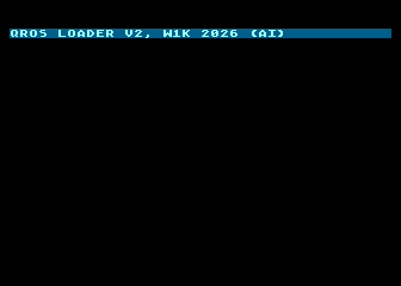

# QROS Loader V2

Turbo tape loader for **QROS / EMO 6600 and 9600** tapes on the Atari XL/XE, written in 6502 assembly (MADS).

<p align="center">
  
</p>

- Reads a QROS tape straight from POKEY's serial input and parses it as the bytes arrive: Atari binary (DOS) files (segments, `INIT`, `RUN`) and cassette boot images (e.g. DETURBO).
- Finds the tape speed itself: 6600 or 9600, including tapes recorded by an emulator.
- Runs under the OS ROM with a copy of the OS in RAM (QROS OS), so the program gets `$0000-$BFFF` except the stack page — about 47 KB — and the QROS cassette handler `C:`.
- Starts on a key press, shows the program name and a percentage or block counter; loading pictures set through the OS shadows are shown.

Errors stop the loader with a message and a coloured border: `NEZNAMY FORMAT` (red), `NECITATELNY BLOK` (orange), `CHYBA RUN ADRESA` (green), `PREPISUJE LOADER` (blue).

## Build

Requires **[MADS](https://github.com/tebe6502/Mad-Assembler)**; `qrosos.inc` sits next to the source.

```
mads qrosload.asm -d:BOOT=0 -d:LOADADR=$4000 -d:DIVISOR=127 -o:qrosload.xex
mads qrosload.asm -d:BOOT=1 -d:LOADADR=$0700 -d:DIVISOR=127 -o:qrosload.bin
```

`qrosload.xex` is the standalone loader (load it, then start the tape); `qrosload.bin` is the boot blob a tape generator writes at the head of a tape. `DIVISOR` is the POKEY divisor tried first (`127` = 6600, `86` = 9600); the last four bytes of the blob (`baudiv`, `total_blk`) can be patched by the generator.

## Credits

- **QROS system & software** — Ing. Matúš Zubor
- **QROS hardware revival (2025)** — Aleister
- **Loader V2** — W1K 2026 (AI)
