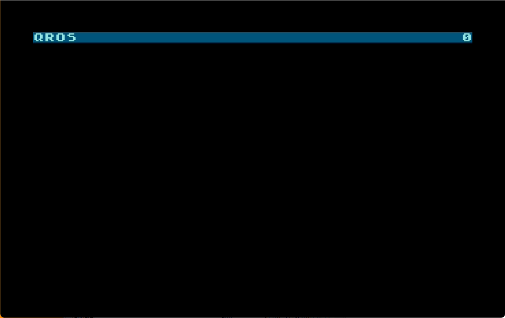

# QROS Loader

A turbo tape loader for the **QROS / EMO** system on the **Atari XL/XE**, written in 6502 assembly.

It reads a QROS tape straight from POKEY's serial input, parses the Atari binary (XEX) format **as the bytes arrive**, and jumps to the loaded program. There is no intermediate buffer for the file — each byte goes directly to its final address, so a tape can fill the whole of RAM.

<p align="center">
  
</p>

While loading it shows the program name taken from the tape header, and progress on the right — a percentage when the tape carries a total block count, a plain block counter otherwise.

## What it does

- **Streamed XEX parser.** Handles multiple segments, optional repeated `FF FF` headers, and calls `INITAD` between segments the way DOS does.
- **Reads 6600 and 9600 tapes with one build.** The two usual QROS speeds sit in a small table; a block that fails its checksum flips to the other divisor and retries. The tape header is sent twice, so it re-syncs before the first data block.
- **SIO checksum on every block.** 132 bytes per block, carry-wrapped sum over the first 131, up to 16 retries.
- **Its own display list.** One text line, living inside the loader's protected memory — the loading program can never overwrite the display, and the display never touches the program.
- **Self-overwrite detection.** Writes into the loader's own pages (`BUFADR` .. `bin_end`) are counted, and reported as an error at the end instead of crashing halfway.
- **Careful hand-off.** A program may have flipped `PORTB` (extended banks, OS ROM off) while loading. Interrupts are only re-enabled if the OS ROM is still in place — otherwise the `$FFFA/$FFFE` vectors would point into RAM.

## Errors

On failure the loader stops, prints the reason on its text line, and flashes the border:

| Border | Message | Meaning |
|--------|---------|---------|
| red `$34` | `CHYBA - NA PASKE NIE JE XEX` | no valid XEX on the tape |
| orange `$24` | `CHYBA - NECITATELNY BLOK` | block unreadable after all retries |
| green `$B4` | `CHYBA - CHYBA RUN ADRESA` | tape never set a RUN address (`$02E0`) |
| blue `$84` | `CHYBA - PROGRAM PREPISUJE LOADER` | the program writes over the loader |

## Build

Requires **[Mad Assembler (MADS)](https://github.com/tebe6502/Mad-Assembler)**. Two variants come out of the same source:

```
mads qrosload.asm -d:BOOT=1 -d:LOADADR=$0700 -d:BUFADR=$0600 -d:DIVISOR=127 -o:qrosload.bin
mads qrosload.asm -d:BOOT=0 -d:LOADADR=$0700 -d:BUFADR=$0600 -d:DIVISOR=127 -o:qrosload.xex
```

- `BOOT=1` — a raw blob with a 6-byte cassette boot header, to be written at the head of a QROS tape.
- `BOOT=0` — a standalone `.xex` (included here as `qrosload.xex`), for loading from disk and then starting the tape.

`DIVISOR` is the POKEY serial divisor — `baud = clock / (2 * (DIVISOR + 7))`. `127` gives 6617 baud PAL (the "6600" mode), `86` gives 9535 baud ("9600"). It only picks which speed is tried *first*; either build reads both.

The last four bytes of the blob are patchable by a tape generator without reassembling:

| Offset | Field | Meaning |
|--------|-------|---------|
| `len-4` | `baudiv` | POKEY divisor to try first |
| `len-2` | `total_blk` | total data blocks on the tape (0 = show a block counter instead of percent) |

At the default addresses the code occupies `$0700-$0C95` with its block buffer at `$0600`.

## Credits

- **QROS system & software** — Ing. Matúš Zubor
- **QROS hardware revival (2025)** — Aleister
- **Loader** — W1K

POKEY register values were verified against the Altirra kernel sources (`Kernel/source/Shared/sio.s`, `cassette.s`, `boot.s`).
